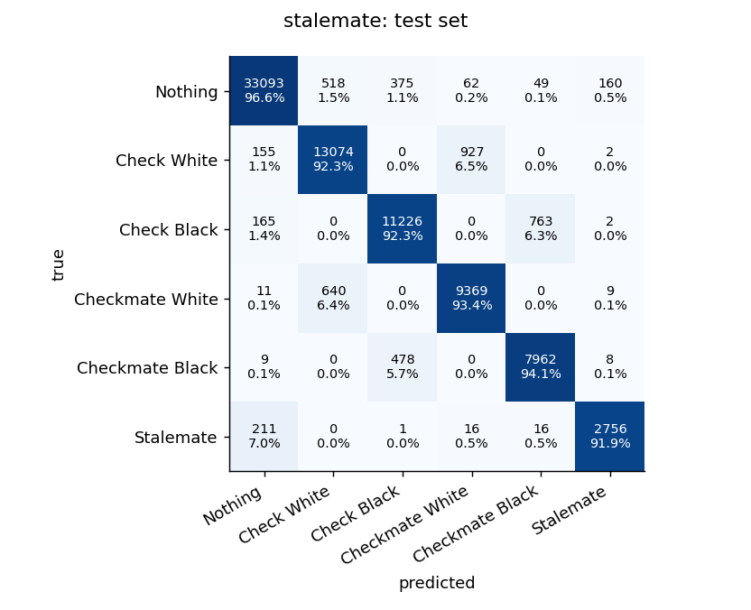

# Training report: stalemate

- `bonus/my_torch_network_stalemate.nn`: 512 relu > 256 relu > 6 softmax, 529158 parameters, config `bonus/stalemate.conf`
- 50 epochs in 5061s on 2625784 boards, best epoch 50 (val_loss 0.1730)


## Test set (82057 boards never used for training or model selection)

Prediction averaged over the 4 symmetries of each board, as `my_torch_analyzer --predict` does (accuracy of the network on the boards alone: 0.9393).

```
                 precision  recall      f1  support
Nothing             0.9836  0.9660  0.9747    34257
Check White         0.9186  0.9234  0.9210    14158
Check Black         0.9293  0.9235  0.9264    12156
Checkmate White     0.9031  0.9342  0.9184    10029
Checkmate Black     0.9058  0.9415  0.9233     8457
Stalemate           0.9384  0.9187  0.9284     3000
accuracy                            0.9442    82057
macro f1                            0.9320

confusion matrix (rows: true class, columns: predicted)
                         0        1        2        3        4        5
Nothing              33093      518      375       62       49      160
Check White            155    13074        0      927        0        2
Check Black            165        0    11226        0      763        2
Checkmate White         11      640        0     9369        0        9
Checkmate Black          9        0      478        0     7962        8
Stalemate              211        0        1       16       16     2756
```



## Per subset

| subset | boards | accuracy | macro F1 | recall Nothing | recall Check White | recall Check Black | recall Checkmate White | recall Checkmate Black | recall Stalemate |
|---|---|---|---|---|---|---|---|---|---|
| 10_pieces | 21306 | 0.9643 | 0.9568 | 0.9762 | 0.9506 | 0.9477 | 0.9649 | 0.9617 | - |
| 20_pieces | 29999 | 0.9378 | 0.9306 | 0.9589 | 0.9044 | 0.9035 | 0.9518 | 0.9488 | - |
| many_pieces | 20252 | 0.9375 | 0.8986 | 0.9718 | 0.9247 | 0.9371 | 0.8270 | 0.8543 | - |
| generated | 10500 | 0.9349 | 0.9308 | 0.9469 | 0.9108 | 0.8803 | 0.9641 | 0.9772 | 0.9187 |
