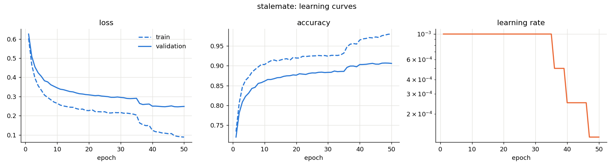

# Training report: stalemate

- `bonus/my_torch_network_stalemate.nn`: 512 relu > 256 relu > 6 softmax, 529158 parameters, config `bonus/stalemate.conf`
- 50 epochs in 1139s on 656446 boards, best epoch 48 (val_loss 0.2465)



## Test set (82057 boards never used for training or model selection)

```
                 precision  recall      f1  support
Nothing             0.9509  0.9379  0.9443    34257
Check White         0.8731  0.8882  0.8806    14158
Check Black         0.8681  0.8606  0.8643    12156
Checkmate White     0.8817  0.8943  0.8880    10029
Checkmate Black     0.8625  0.8941  0.8780     8457
Stalemate           0.8878  0.8517  0.8693     3000
accuracy                            0.9048    82057
macro f1                            0.8874

confusion matrix (rows: true class, columns: predicted)
                         0        1        2        3        4        5
Nothing              32128      847      766      114      141      261
Check White            521    12575        0     1057        0        5
Check Black            650        0    10461        0     1038        7
Checkmate White         60      973        0     8969        0       27
Checkmate Black         51        0      822        0     7561       23
Stalemate              378        7        2       32       26     2555
```


## Per subset

| subset | boards | accuracy | macro F1 | recall Nothing | recall Check White | recall Check Black | recall Checkmate White | recall Checkmate Black | recall Stalemate |
|---|---|---|---|---|---|---|---|---|---|
| 10_pieces | 21306 | 0.9331 | 0.9247 | 0.9561 | 0.9086 | 0.8959 | 0.9261 | 0.9423 | - |
| 20_pieces | 29999 | 0.8944 | 0.8851 | 0.9217 | 0.8786 | 0.8430 | 0.9069 | 0.8919 | - |
| many_pieces | 20252 | 0.9067 | 0.8597 | 0.9501 | 0.8975 | 0.8788 | 0.8020 | 0.7941 | - |
| generated | 10500 | 0.8737 | 0.8593 | 0.9071 | 0.7959 | 0.7303 | 0.9230 | 0.9344 | 0.8517 |
