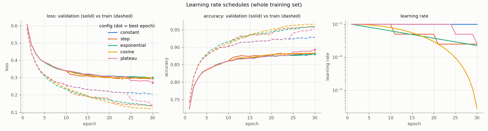
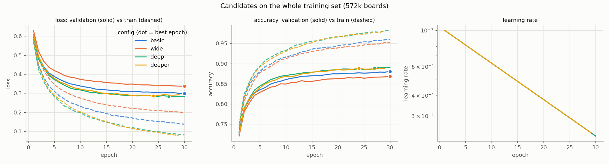
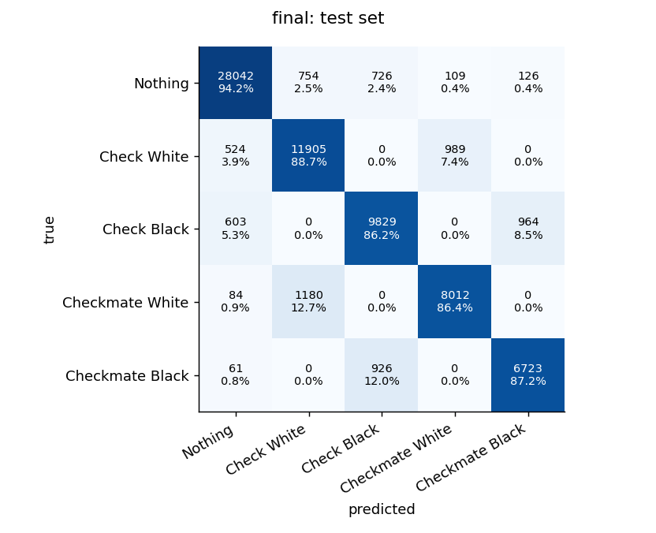
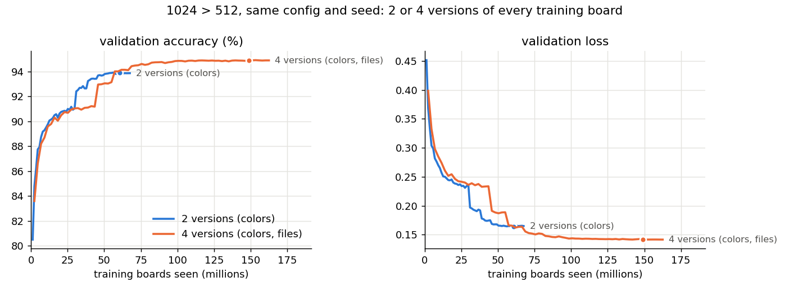

# Benchmarks

Tout se régénère avec `sh scripts/run_experiments.sh [nom]`. Chaque comparaison entraîne ses variantes en parallèle, sur les mêmes données et avec la même seed : seule la variable étudiée change. On choisit sur la **validation** ; le **test** ne sert qu'au chiffre final. Courbes : tirets = train, trait plein = validation, point = meilleur epoch. Les CSV complets sont à côté de chaque image dans `docs/img/`.

Machine : i7-9700K (8 cœurs), Python 3.12, numpy 1.26 avec OpenBLAS (les entraînements des §9 et §10 tournent dans un conteneur `python:3.12-slim` + numpy 1.26.4 de pip). Sans OpenBLAS, tout est plus lent, résultats identiques (§7).

## 1. Sur-apprentissage et régularisation

`basic.conf` (256 > 128), **100k** positions (assez peu pour que le sur-apprentissage se voie), 40 epochs.


| Variante | Meilleure val_loss | val_acc | Écart train − val (fin) | Durée |
|---|---|---|---|---|
| aucune | 0,697 (epoch 4), puis **2,82** au 40ᵉ | 68,9 % | 30 pts | 99 s |
| L2 1e-4 | 0,684 | 69,1 % | 29 pts | 108 s |
| dropout 0,2 | 0,669 | 69,9 % | 28 pts | 107 s |
| L2 + dropout | **0,654** | **70,7 %** | 27 pts | 111 s |
| + early stopping | **0,654** (arrêt epoch 11) | **70,7 %** | 24 pts | **36 s** |

Sans régularisation, le réseau apprend le train par cœur et la val_loss explose. L2 + dropout donnent la meilleure validation, et l'early stopping obtient le même résultat en 3× moins de temps. Le vrai remède reste la quantité de données (§5).

## 2. Baisse du learning rate

`basic.conf` sur **tout le train** (572k), 30 epochs. Sur 100k positions, tout sur-apprend avant que les schedules ne diffèrent.



| constant | step | exponential | cosine | **plateau** |
|---|---|---|---|---|
| 88,1 % | 88,4 % | 88,0 % | 88,0 % | **89,3 %** (val_loss 0,271) |

Les baisses programmées d'avance aident surtout à mémoriser le train. **plateau** garde le grand pas tant que la validation progresse, puis le divise par 2 : chaque baisse fait gagner un palier. C'est le schedule du réseau final.

## 3. Architecture

**Grille** (`img/hpo_architecture/`) : 1 à 3 couches × 64 à 512 neurones, 150k positions, 15 epochs. Une seule couche de 512 gagne (77,3 %) : sur peu de données, les réseaux profonds sur-apprennent plus tôt.

**Confirmation sur tout le train** (572k) des meilleures architectures :



| Config | Couches cachées | Paramètres | val_acc | F1 macro |
|---|---|---|---|---|
| `wide` | 512 | 399k | 86,9 % | 0,850 |
| `basic` | 256 > 128 | 232k | 88,0 % | 0,864 |
| **`deep`** | **512 > 256** (dropout 0,3) | 529k | **88,9 %** | **0,871** |
| `deeper` | 512 > 256 > 128 | 561k | 88,9 % | 0,870 |

**Le classement s'inverse** : le gagnant sur 150k finit dernier sur 572k. La profondeur ne paie qu'avec assez de données, et une 3ᵉ couche n'apporte plus rien. On garde `deep`, le plus petit des deux meilleurs.

## 4. Recherche aléatoire et algorithme génétique

9 hyperparamètres à la fois (`configs/search/`) : couches, largeur, activation, dropout, optimiseur, lr, batch, L2. Recherche aléatoire : 24 essais, 13,5 min. Algorithme génétique : 8 individus × 4 générations, élitisme, tournoi, croisement, mutation, 5,5 min. Résultats dans `img/hpo_random/trials.csv` et `img/hpo_genetic/` (graphe + CSV).

- Adam domine : la génétique élimine Momentum, et 14 de ses 25 individus sont des Adam.
- LeakyReLU ≈ ReLU (égalité en comparaison directe, §6).
- **Aucun essai ne bat les réglages de `basic.conf` élargis** : val_loss 0,565 au mieux contre 0,539. Ce qui compte d'abord, c'est l'architecture.
- Un petit budget (10-15 epochs) favorise ce qui apprend vite, pas ce qui généralise : d'où la confirmation sur tout le train (§3).

## 5. Quantité de données


De 25k à 572k positions, la validation passe de 61 % à 87 % et l'écart train/val de 19 à 7 points. **Chaque doublement des données rapporte encore 5 à 7 points, sans plateau**, pour un temps d'entraînement qui ne fait que doubler.

## 6. Activations, batch, optimiseurs (100k positions, 30 epochs)

- Activations (`img/activations.png`) : **ReLU 70,7 %**, LeakyReLU 70,7 %, ELU 69,9 %, tanh 68,5 %, sigmoïde 63,5 %.
- Batch (`img/batch_size.png`) : 32 → 71,7 % en 204 s ; 128 → 71,4 %, 116 s ; **256 → 70,7 %, 95 s** ; 1024 → 70,4 %, 75 s ; 4096 → 69,6 %, pas convergé.
- Optimiseurs (`img/optimizers.png`) : SGD 66,9 %, Momentum 66,9 %, RMSprop 70,0 %, **Adam 70,7 %**.

- **ReLU contre sigmoïde** : la sigmoïde sature (dérivée ≤ 0,25) et plafonne 7 points plus bas. ReLU apprend si vite qu'elle sur-apprend ensuite, d'où la régularisation.
- **Batch, stabilité contre temps** : 32 gagne 1 point mais coûte 2,2× le temps de 256 ; 4096 ne converge pas en 30 epochs.
- **Adam** converge 5× plus vite que SGD : un pas par paramètre, utile quand chaque entrée est rarement active.

## 7. Vitesse et parallélisation

| Optimisation | Mesure | Gain |
|---|---|---|
| mini-batch de 256 au lieu d'1 exemple à la fois | 738 → 73 413 exemples/s | **99×** |
| float32 au lieu de float64 | 3,19 → 1,35 s/epoch | **2,4×** |
| 4 threads BLAS (un seul entraînement) | 1,35 → 0,93 s/epoch | 1,45× |
| remise à 0 des nombres dénormalisés (L2) | 0,36 → 0,28 s/epoch | 1,3× |
| **entraînements en parallèle** (16 entraînements) | 62 s → 24 s | **2,6×** à 4 processus |


Un processus par entraînement, données en mémoire partagée (jamais copiées). Le gain plafonne dès 4 processus, et ce n'est pas le démarrage des processus : 8 entraînements simultanés débordent les 12 Mo de cache L3 partagés et se disputent la bande passante mémoire (8 threads BLAS sont aussi plus lents que 4). Sur le laptop Core 5 120U, le plafond était de 3,2× (limite : 15 W).

**Le coût de `--predict` dépend du BLAS installé.** Le dump (image `epitechcontent/epitest-docker` : Ubuntu 26.04, Python 3.14.4, numpy 2.3.5) n'a que le BLAS de référence (`libblas3`), sans OpenBLAS, comme le numpy d'Ubuntu sur nos machines. Même code, mêmes réponses, mais 10 à 40× plus lent. D'où une optimisation propre aux entrées 0/1 : un plateau encodé n'a que 15 entrées à 1 sur 773 en moyenne (37 au plus), donc `x @ W` de la 1ʳᵉ couche est la somme de 15 lignes de `W`. `Network.predict_proba` additionne ces lignes au lieu de faire le produit matriciel (`my_torch/layers.py`, `sum_active_rows`) : mêmes additions dans le même ordre, sorties **identiques au bit près** sur le dump (vérifié sur les 71 557 plateaux du test). L'entraînement garde le produit matriciel.

| `--predict` sur le test (71 557 plateaux), 1024 > 512 | dump (BLAS de référence) | i7-9700K, numpy d'Ubuntu (BLAS de référence) | OpenBLAS |
|---|---|---|---|
| réseau seul, produit matriciel (avant le 5 novembre) | 14,4 s (1 000 plateaux : 0,34 s) | 44 s | 2,3 s |
| moyenne sur les 4 symétries, produit matriciel | 62 s de calcul | ≈ 180 s (4 × 44 s) | — |
| **moyenne sur les 4 symétries, 1ʳᵉ couche par lignes actives (livré)** | **26,6 s** (1 000 plateaux : 0,48 s) | **75 s** | 8,1 s |

La moyenne sur les symétries (§10) coûte 4 passages dans le réseau ; la 1ʳᵉ couche par lignes actives (60 % du calcul) en rattrape plus de la moitié : 62 → 25 s de calcul sur le dump (2,4×).

## 8. Premier réseau final (512 > 256)

`configs/final.conf` = architecture `deep` + schedule plateau, 50 epochs max. Arrêt anticipé à l'epoch 41, poids de l'epoch 36 restaurés. Rapport complet : `docs/report/final_512_256/report.md`.

| Test (71 557 positions) | `basic` | **`final`** |
|---|---|---|
| accuracy / F1 macro | 87,95 % / 0,863 | **90,15 % / 0,884** |
| accuracy 10 / 20 / beaucoup de pièces | 89,8 / 86,4 / 88,4 % | 92,3 / 88,4 / 90,5 % |
| rappel des mats, beaucoup de pièces | 78,0 / 75,1 % | 76,8 / 77,1 % |



Il n'y a jamais de confusion de couleur. Les erreurs restantes sont **échec ↔ mat** (≈ 4 000), puis **échec ↔ rien**. Le point faible : les mats dans les positions chargées, les plus rares du dataset.

## 9. Inversion des couleurs (réseau livré jusqu'au 5 novembre)

Les règles sont symétriques : une position et son miroir (plateau retourné verticalement, majuscules et minuscules échangées, trait et roques échangés, White et Black échangés dans le label) ont le même statut. `scripts/train.py --flip-colors` ajoute le miroir de chaque plateau au train, jamais à la validation ni au test (`analyzer/augment.py`). Le générateur de coups du bonus confirme le label miroir sur 2 008 positions sur 2 008.

| Réseau | Plateaux de train | Epochs (meilleur) | val_loss | Test | F1 macro 5 / 3 classes |
|---|---|---|---|---|---|
| 512 > 256, sans miroirs (§8) | 572 446 | 41 (36) | 0,2525 | 90,15 % | 0,884 / 0,895 |
| 512 > 256, miroirs | 1 144 892 | 71 (66) | 0,1726 | 93,52 % | 0,922 / 0,930 |
| **1024 > 512, miroirs** | 1 144 892 | 59 (53) | **0,1641** | **93,82 %** | **0,924 / 0,933** |

L'accuracy est la même en 5 et en 3 classes (couleur ignorée) : aucun de ces réseaux ne confond les couleurs. Le candidat est choisi sur la val_loss, le test ne sert qu'à la comparaison avec l'ancien réseau.

```
Test en 3 classes     avant (512 > 256)        après (1024 > 512)
(lignes : vraie)   Nothing  Check   Mat     Nothing  Check   Mat
Nothing              28042   1480    235      28783    854    120
Check                 1127  21734   1953        426  22813   1575
Checkmate              145   2106  14735         45   1399  15542
```

- **Les miroirs font l'essentiel** : +3,37 points à architecture égale. L'ancien réseau s'était arrêté à l'epoch 41 sur 50 : le plafond d'epochs ne le limitait pas.
- **La capacité apporte peu** : +0,30 point (IC 95 % ±0,15) pour 2,5× plus de paramètres, un fichier de 5,3 Mo contre 2,1 Mo et un `--predict` de 4,5 s contre 2,5 s sur tout le test.
- **Gain mesuré sur les mêmes plateaux** : 3 976 erreurs corrigées, 1 349 nouvelles, soit +3,67 points (IC 95 % ±0,20).
- **Pas de fuite par les miroirs** : 365 plateaux du test (0,51 %) sont le miroir d'un plateau du train. Sans eux : 93,80 % contre 90,13 %, le même écart.
- **Sur-apprentissage** : en fin d'entraînement, 98,6 % sur le train contre 93,9 % en validation. L'écart reste la limite principale.
- **Erreurs restantes** : échec ↔ mat (≈ 3 000, contre ≈ 4 000). Sur 10 / 20 / beaucoup de pièces : 95,6 / 92,8 / 93,5 % (contre 92,3 / 88,4 / 90,5 %). Rappel des mats dans les positions chargées : 83,0 / 82,9 % (contre 76,8 / 77,1 %).

```bash
python3 scripts/train.py configs/final.conf --data data/chess.npz --out final_flip.nn --epochs 80 --flip-colors
python3 scripts/train.py configs/large.conf --data data/chess.npz --out large_x2.nn --report docs/report/final_x2 --flip-colors
python3 scripts/evaluate.py large_x2.nn final_flip.nn --data data/chess.npz
```

Rapport complet : `docs/report/final_x2/report.md` (ce réseau se retrouve avec `git show 70d6402:my_torch_network_final.nn`).

## 10. Les 4 symétries : 4× plus de plateaux, et une réponse moyennée (réseau livré)

**Pourquoi.** Avec le réseau du §9, la moulinette a validé « Check/Nothing » jusqu'au niveau *High*, mais pas « Full » ni « Full + color » au niveau *High*. Mesurés sur notre test, ces deux scores valaient 94,55 % (validé) et 93,82 % (refusé) : il fallait gagner sur les confusions échec ↔ mat. Le §9 montrait la voie : le réseau sur-apprend (98,6 % sur le train, 93,9 % en validation) et les miroirs, de nouvelles données gratuites, avaient fait l'essentiel du gain.

**Une 2ᵉ symétrie.** Le plateau inversé gauche-droite (colonne a ↔ h, roques côté roi ↔ côté dame) a le même label : chaque pièce se déplace de la même façon dans le miroir, et le roque, seule règle asymétrique, ne change jamais un échec (un roi en échec ne roque pas). Avec l'inversion des couleurs, chaque position a donc 4 versions (`analyzer/augment.py`). Le générateur de coups du bonus confirme le label des 4 versions des **723 019 positions du dataset** et des 105 000 positions générées du bonus, sans une erreur : `python3 bonus/validate_movegen.py --symmetries` (20 s).

**Deux usages.**
1. **À l'entraînement** : les 572 446 plateaux de train deviennent 2 289 784 (`scripts/train.py --flip-colors --flip-files`). Validation et test ne sont jamais augmentés.
2. **À la prédiction** : `--predict` fait passer les 4 versions de chaque plateau dans le réseau et moyenne ses 4 réponses, chacune ramenée aux labels du plateau d'origine (`symmetric_proba`). Le choix 4 versions plutôt que 2 (couleurs seules) s'est fait sur la validation : 95,19 % contre 95,10 % (réseau seul : 94,89 %).



Même config (`configs/large.conf`), même seed : seule la quantité de plateaux change. À nombre de plateaux vus égal, les deux courbes se suivent au début. Celle à 2 versions stagne plus tôt : son learning rate baisse dès 30 millions de plateaux vus (les marches) et elle plafonne vers 94 %. Celle à 4 versions progresse plus longtemps avant chaque baisse et finit 1 point plus haut, avec une val_loss 14 % plus basse.

| Test (71 557 positions) | Plateaux de train | Epochs (meilleur) | val_loss | Réseau seul | `--predict` (4 versions) | F1 macro (`--predict`) |
|---|---|---|---|---|---|---|
| 1024 > 512, 2 versions (§9) | 1 144 892 | 59 (53) | 0,1641 | 93,82 % | 94,21 % | 0,929 |
| **1024 > 512, 4 versions (livré)** | 2 289 784 | 71 (65) | **0,1414** | **95,01 %** | **95,34 %** | **0,942** |

- **Gain par rapport à ce que la moulinette a noté** (réseau du §9 seul) : +1,52 point, IC 95 % ±0,14 ; 1 929 erreurs corrigées, 841 nouvelles. « Full » et « Full + color » passent de 93,82 % à 95,34 %, au-dessus des 94,55 % de « Check/Nothing » qui validaient déjà le niveau *High*. Ce n'est pas une garantie : les plateaux de la moulinette ne sont pas les nôtres.
- **Le sur-apprentissage recule** : en fin d'entraînement, 97,2 % sur le train contre 94,9 % en validation, un écart de 2,3 points au lieu de 4,7.
- **Erreurs restantes** : échec ↔ mat, 2 419 au lieu de 2 974 ; toujours aucune confusion de couleur (5 classes = 3 classes). Sur 10 / 20 / beaucoup de pièces : 96,9 / 94,7 / 94,8 % (réseau du §9 seul : 95,6 / 92,8 / 93,5 %). Rappel des mats dans les positions chargées : 85,0 / 85,8 % (contre 83,0 / 82,9 %).
- **Pas de fuite par les symétries** : 679 plateaux du test (0,95 %) sont une version d'un plateau du train (365 par les couleurs, 325 par les colonnes, 304 par les deux). Sans eux : 95,31 % contre 94,17 % pour le réseau du §9, le même écart.
- **Coût** : chaque epoch voit 2× plus de plateaux (71 epochs en 3,2 h ici, OpenBLAS 6 threads, contre 59 epochs en 3,6 h pour le §9 sur une autre machine), et un `--predict` qui fait 4 passages dans le réseau, compensés en partie par la 1ʳᵉ couche par lignes actives (§7) : 26,6 s au lieu de 14,4 s pour le test entier sur le dump, 0,48 s au lieu de 0,34 s pour 1 000 plateaux.

```bash
python3 bonus/validate_movegen.py --symmetries
python3 scripts/train.py configs/large.conf --data data/chess.npz --out my_torch_network_final.nn --report docs/report/final --flip-colors --flip-files
python3 scripts/evaluate.py my_torch_network_final.nn --data data/chess.npz
python3 scripts/plot_histories.py large_x2.nn "2 versions (colors)" my_torch_network_final.nn "4 versions (colors, files)" --out docs/img/symmetries.png
```

Rapport complet : `docs/report/final/report.md`.
