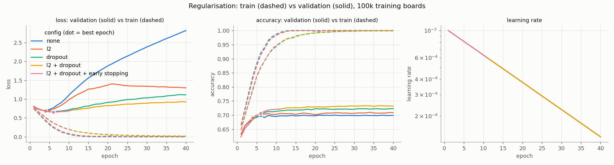
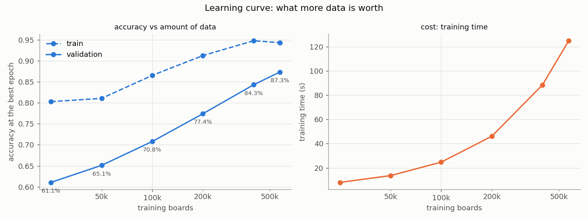
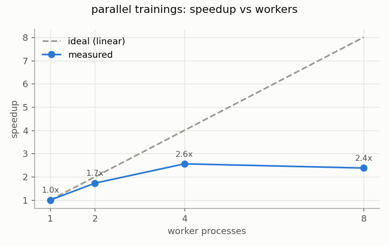
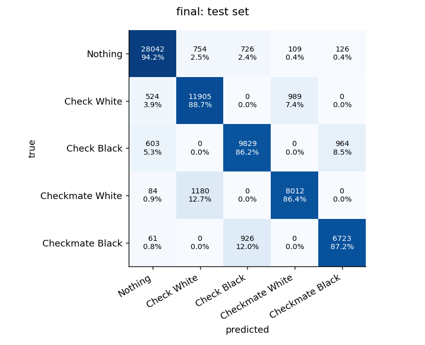

# Benchmarks

Tout se régénère avec `sh scripts/run_experiments.sh [nom]`. Chaque comparaison entraîne ses variantes en parallèle, sur les mêmes données et avec la même seed : seule la variable étudiée change. On choisit sur la **validation** ; le **test** ne sert qu'au chiffre final. Courbes : tirets = train, trait plein = validation, point = meilleur epoch. Les CSV complets sont à côté de chaque image dans `docs/img/`.

Machine : i7-9700K (8 cœurs), Python 3.12, numpy 1.26.

## 1. Sur-apprentissage et régularisation

`basic.conf` (256 > 128), **100k** positions (assez peu pour que le sur-apprentissage se voie), 40 epochs.

| Variante | Meilleure val_loss | val_acc | Écart train − val (fin) | Durée |
|---|---|---|---|---|
| aucune | 0,697 (epoch 4), puis **2,82** au 40ᵉ | 68,9 % | 30 pts | 99 s |
| L2 1e-4 | 0,684 | 69,1 % | 29 pts | 108 s |
| dropout 0,2 | 0,669 | 69,9 % | 28 pts | 107 s |
| L2 + dropout | **0,654** | **70,7 %** | 27 pts | 111 s |
| + early stopping | **0,654** (arrêt epoch 11) | **70,7 %** | 24 pts | **36 s** |

Sans régularisation, le réseau apprend le train par cœur et la val_loss explose. L2 + dropout donnent la meilleure validation, et l'early stopping obtient le même résultat en 3× moins de temps. Le vrai remède reste la quantité de données (§5).

## 2. Baisse du learning rate

`basic.conf` sur **tout le train** (572k), 30 epochs. Sur 100k positions, tout sur-apprend avant que les schedules ne diffèrent.

| constant | step | exponential | cosine | **plateau** |
|---|---|---|---|---|
| 88,1 % | 88,4 % | 88,0 % | 88,0 % | **89,3 %** (val_loss 0,271) |

Les baisses programmées d'avance aident surtout à mémoriser le train. **plateau** garde le grand pas tant que la validation progresse, puis le divise par 2 : chaque baisse fait gagner un palier. C'est le schedule du réseau final.

## 3. Architecture

**Grille** (`img/hpo_architecture/`) : 1 à 3 couches × 64 à 512 neurones, 150k positions, 15 epochs. Une seule couche de 512 gagne (77,3 %) : sur peu de données, les réseaux profonds sur-apprennent plus tôt.

**Confirmation sur tout le train** (572k) des meilleures architectures :

| Config | Couches cachées | Paramètres | val_acc | F1 macro |
|---|---|---|---|---|
| `wide` | 512 | 399k | 86,9 % | 0,850 |
| `basic` | 256 > 128 | 232k | 88,0 % | 0,864 |
| **`deep`** | **512 > 256** (dropout 0,3) | 529k | **88,9 %** | **0,871** |
| `deeper` | 512 > 256 > 128 | 561k | 88,9 % | 0,870 |

**Le classement s'inverse** : le gagnant sur 150k finit dernier sur 572k. La profondeur ne paie qu'avec assez de données, et une 3ᵉ couche n'apporte plus rien. On garde `deep`, le plus petit des deux meilleurs.

## 4. Recherche aléatoire et algorithme génétique

9 hyperparamètres à la fois (`configs/search/`) : couches, largeur, activation, dropout, optimiseur, lr, batch, L2. Recherche aléatoire : 24 essais, 13,5 min. Algorithme génétique : 8 individus × 4 générations, élitisme, tournoi, croisement, mutation, 5,5 min. Résultats dans `img/hpo_random/trials.csv` et `img/hpo_genetic/` (graphe + CSV).

- Adam domine : la génétique élimine Momentum, et 14 de ses 25 individus sont des Adam.
- LeakyReLU ≈ ReLU (égalité en comparaison directe, §6).
- **Aucun essai ne bat les réglages de `basic.conf` élargis** : val_loss 0,565 au mieux contre 0,539. Ce qui compte d'abord, c'est l'architecture.
- Un petit budget (10-15 epochs) favorise ce qui apprend vite, pas ce qui généralise : d'où la confirmation sur tout le train (§3).

## 5. Quantité de données

De 25k à 572k positions, la validation passe de 61 % à 87 % et l'écart train/val de 19 à 7 points. **Chaque doublement des données rapporte encore 5 à 7 points, sans plateau**, pour un temps d'entraînement qui ne fait que doubler.

## 6. Activations, batch, optimiseurs (100k positions, 30 epochs)

- Activations (`img/activations.png`) : **ReLU 70,7 %**, LeakyReLU 70,7 %, ELU 69,9 %, tanh 68,5 %, sigmoïde 63,5 %.
- Batch (`img/batch_size.png`) : 32 → 71,7 % en 204 s ; 128 → 71,4 %, 116 s ; **256 → 70,7 %, 95 s** ; 1024 → 70,4 %, 75 s ; 4096 → 69,6 %, pas convergé.
- Optimiseurs (`img/optimizers.png`) : SGD 66,9 %, Momentum 66,9 %, RMSprop 70,0 %, **Adam 70,7 %**.

- **ReLU contre sigmoïde** : la sigmoïde sature (dérivée ≤ 0,25) et plafonne 7 points plus bas. ReLU apprend si vite qu'elle sur-apprend ensuite, d'où la régularisation.
- **Batch, stabilité contre temps** : 32 gagne 1 point mais coûte 2,2× le temps de 256 ; 4096 ne converge pas en 30 epochs.
- **Adam** converge 5× plus vite que SGD : un pas par paramètre, utile quand chaque entrée est rarement active.

## 7. Vitesse et parallélisation

| Optimisation | Mesure | Gain |
|---|---|---|
| mini-batch de 256 au lieu d'1 exemple à la fois | 738 → 73 413 exemples/s | **99×** |
| float32 au lieu de float64 | 3,19 → 1,35 s/epoch | **2,4×** |
| 4 threads BLAS (un seul entraînement) | 1,35 → 0,93 s/epoch | 1,45× |
| remise à 0 des nombres dénormalisés (L2) | 0,36 → 0,28 s/epoch | 1,3× |
| **entraînements en parallèle** (16 entraînements) | 62 s → 24 s | **2,6×** à 4 processus |

Un processus par entraînement, données en mémoire partagée (jamais copiées). Le gain plafonne dès 4 processus, et ce n'est pas le démarrage des processus : 8 entraînements simultanés débordent les 12 Mo de cache L3 partagés et se disputent la bande passante mémoire (8 threads BLAS sont aussi plus lents que 4). Sur le laptop Core 5 120U, le plafond était de 3,2× (limite : 15 W). À l'usage, `--predict` traite 54 000 positions par seconde.

## 8. Réseau final

`configs/final.conf` = architecture `deep` + schedule plateau, 50 epochs max. Arrêt anticipé à l'epoch 41, poids de l'epoch 36 restaurés. Rapport complet : `docs/report/final/report.md`.

| Test (71 557 positions) | `basic` | **`final`** |
|---|---|---|
| accuracy / F1 macro | 87,95 % / 0,863 | **90,15 % / 0,884** |
| accuracy 10 / 20 / beaucoup de pièces | 89,8 / 86,4 / 88,4 % | 92,3 / 88,4 / 90,5 % |
| rappel des mats, beaucoup de pièces | 78,0 / 75,1 % | 76,8 / 77,1 % |

Il n'y a jamais de confusion de couleur. Les erreurs restantes sont **échec ↔ mat** (≈ 4 000), puis **échec ↔ rien**. Le point faible : les mats dans les positions chargées, les plus rares du dataset.
