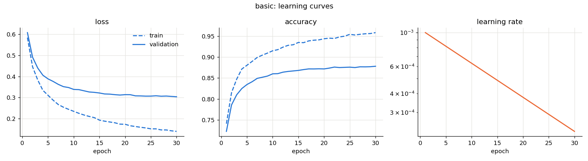
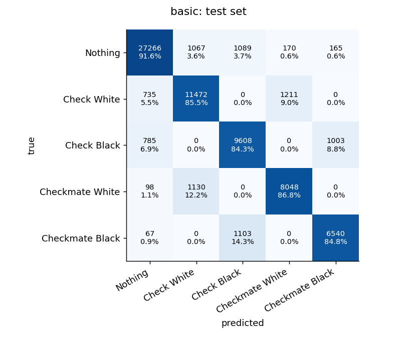

# Training report: basic

- `docs/networks/baseline_basic.nn`: 256 relu > 128 relu > 5 softmax, 231685 parameters, config `configs/basic.conf`
- 30 epochs in 202s on 572446 boards, best epoch 30 (val_loss 0.3035)



## Test set (71557 boards never used for training or model selection)

```
                 precision  recall      f1  support
Nothing             0.9418  0.9163  0.9289    29757
Check White         0.8393  0.8550  0.8470    13418
Check Black         0.8142  0.8431  0.8284    11396
Checkmate White     0.8535  0.8676  0.8605     9276
Checkmate Black     0.8485  0.8482  0.8484     7710
accuracy                            0.8795    71557
macro f1                            0.8626

confusion matrix (rows: true class, columns: predicted)
                         0        1        2        3        4
Nothing              27266     1067     1089      170      165
Check White            735    11472        0     1211        0
Check Black            785        0     9608        0     1003
Checkmate White         98     1130        0     8048        0
Checkmate Black         67        0     1103        0     6540
```



## Per subset

| subset | boards | accuracy | macro F1 | recall Nothing | recall Check White | recall Check Black | recall Checkmate White | recall Checkmate Black |
|---|---|---|---|---|---|---|---|---|
| 10_pieces | 21306 | 0.8976 | 0.8874 | 0.9243 | 0.8621 | 0.8524 | 0.9049 | 0.9085 |
| 20_pieces | 29999 | 0.8639 | 0.8542 | 0.8932 | 0.8376 | 0.8288 | 0.8806 | 0.8468 |
| many_pieces | 20252 | 0.8836 | 0.8322 | 0.9315 | 0.8694 | 0.8548 | 0.7798 | 0.7513 |
