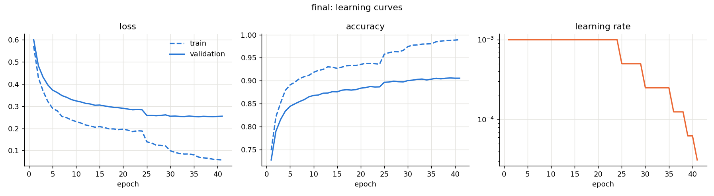
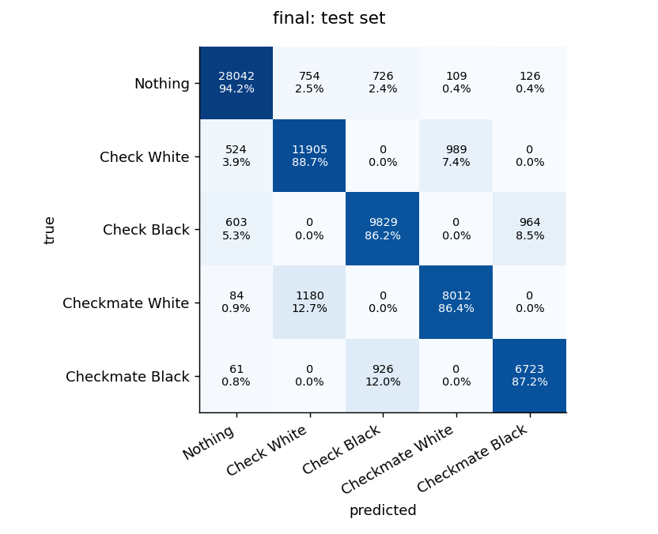

# Training report: final

- `my_torch_network_final.nn`: 512 relu > 256 relu > 5 softmax, 528901 parameters, config `configs/final.conf`
- 41 epochs in 915s on 572446 boards, best epoch 36 (val_loss 0.2525), early stopping



## Test set (71557 boards never used for training or model selection)

```
                 precision  recall      f1  support
Nothing             0.9566  0.9424  0.9494    29757
Check White         0.8603  0.8872  0.8735    13418
Check Black         0.8561  0.8625  0.8593    11396
Checkmate White     0.8795  0.8637  0.8715     9276
Checkmate Black     0.8605  0.8720  0.8662     7710
accuracy                            0.9015    71557
macro f1                            0.8840

confusion matrix (rows: true class, columns: predicted)
                         0        1        2        3        4
Nothing              28042      754      726      109      126
Check White            524    11905        0      989        0
Check Black            603        0     9829        0      964
Checkmate White         84     1180        0     8012        0
Checkmate Black         61        0      926        0     6723
```



## Per subset

| subset | boards | accuracy | macro F1 | recall Nothing | recall Check White | recall Check Black | recall Checkmate White | recall Checkmate Black |
|---|---|---|---|---|---|---|---|---|
| 10_pieces | 21306 | 0.9229 | 0.9116 | 0.9510 | 0.8970 | 0.8758 | 0.9137 | 0.9305 |
| 20_pieces | 29999 | 0.8843 | 0.8741 | 0.9238 | 0.8694 | 0.8411 | 0.8741 | 0.8722 |
| many_pieces | 20252 | 0.9046 | 0.8539 | 0.9526 | 0.9000 | 0.8805 | 0.7682 | 0.7714 |
