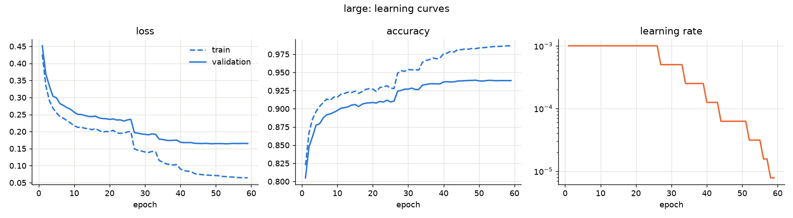
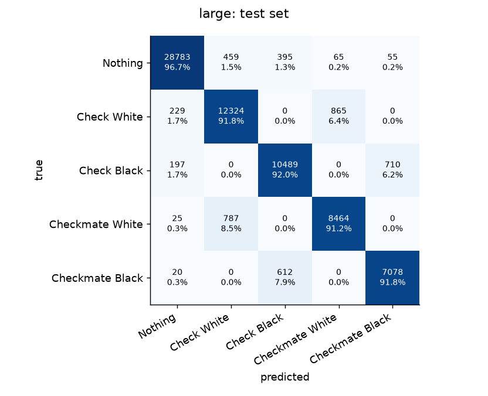

# Training report: large

> Network delivered until the 5th of November, trained on 2 versions of every board (colors swapped); replaced by the one of `docs/report/final/`. It is still in git: `git show 70d6402:my_torch_network_final.nn`. Its test results below are those of the network alone (93.82 %); averaged over the 4 symmetries like `--predict` does now, it reaches 94.21 %.

- `my_torch_network_final.nn`: 1024 relu > 512 relu > 5 softmax, 1319941 parameters, config `configs/large.conf`
- 59 epochs in 12820s on 1144892 boards, best epoch 53 (val_loss 0.1641), early stopping



## Test set (71557 boards never used for training or model selection)

```
                 precision  recall      f1  support
Nothing             0.9839  0.9673  0.9755    29757
Check White         0.9082  0.9185  0.9133    13418
Check Black         0.9124  0.9204  0.9164    11396
Checkmate White     0.9010  0.9125  0.9067     9276
Checkmate Black     0.9025  0.9180  0.9102     7710
accuracy                            0.9382    71557
macro f1                            0.9244

confusion matrix (rows: true class, columns: predicted)
                         0        1        2        3        4
Nothing              28783      459      395       65       55
Check White            229    12324        0      865        0
Check Black            197        0    10489        0      710
Checkmate White         25      787        0     8464        0
Checkmate Black         20        0      612        0     7078
```



## Per subset

| subset | boards | accuracy | macro F1 | recall Nothing | recall Check White | recall Check Black | recall Checkmate White | recall Checkmate Black |
|---|---|---|---|---|---|---|---|---|
| 10_pieces | 21306 | 0.9564 | 0.9477 | 0.9719 | 0.9406 | 0.9383 | 0.9478 | 0.9530 |
| 20_pieces | 29999 | 0.9278 | 0.9195 | 0.9577 | 0.9021 | 0.8991 | 0.9245 | 0.9253 |
| many_pieces | 20252 | 0.9346 | 0.8943 | 0.9723 | 0.9188 | 0.9327 | 0.8299 | 0.8290 |
